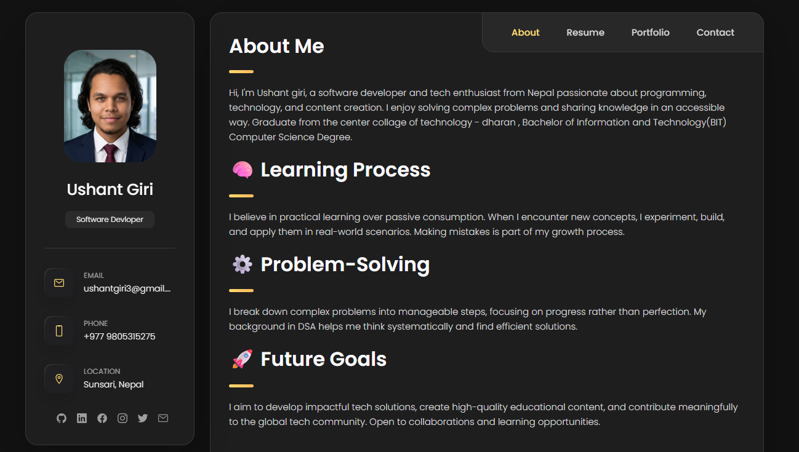

# Ushant Giri — Systems Developer, Founder & Engineering Portfolio

[](assets/js/rep.js)
[](assets/css/sty.css)
[]()
[]()
[](LICENSE)

An Apple-inspired personal engineering portfolio and systems sandbox designed by **Ushant Giri**, a software developer, founder, and systems builder based in Sunsari, Nepal.

The platform showcases production systems, startup ventures, live transit telemetry, low-level computational foundations in C/C++, and full-stack cloud architecture (FastAPI, Supabase, Firebase, Node.js).

---

## 📸 Portfolio Preview



---

## 💎 Core Architecture & Capabilities

- **Apple WWDC Design Language**: Engineered with translucent acrylic materials (`backdrop-filter: blur(28px)`), sub-pixel optical typography tracking, and balanced leading.
- **Micro-Interaction Physics**: Critically damped spring transitions (`cubic-bezier(0.16, 1, 0.3, 1)`), instantaneous tactile touch response (`:active { transform: scale(0.97) }`), and smooth sliding pill indicators.
- **Interactive Developer CLI Terminal**: A functional in-browser UNIX terminal sandbox (`data-terminal-dialog`) supporting commands (`skills`, `kolve`, `cct_bus`, `student_db`, `binary_search`, `fetch_metrics`, `help`, `clear`).
- **Interactive Binary Search Visualizer**: Step-by-step visual simulation of memory pointer arithmetic ($O(\log N)$) with Low, Mid, and High register updates.
- **Spotlight Search (`⌘K` / `Ctrl+K`)**: Rapid global keyboard command palette indexing all projects, milestones, sections, and one-click contact utilities.
- **Client-Side WhatsApp Concierge**: Instant offline concierge drawer answering queries about KOLVE, technical stack, availability, and routing direct prefilled messages to WhatsApp without third-party API exposure.
- **Asynchronous AJAX Contact Pipeline**: FormSubmit submission intercepted via `fetch()` with live status feedback, field validation, and fallback transmission channels.
- **Persistent Dual-Theme Engine**: Auto-detects OS color preferences (`prefers-color-scheme`) with instant toggle persistence in `localStorage`.
- **Zero Heavy External Dependencies**: Pure native web standards (HTML5, CSS3, ES6+ JavaScript, inline SVGs) for sub-100ms first contentful paint and zero CDN vulnerabilities.

---

## 🚀 Ventures & Featured Projects

| Project / Venture | Role | Core Technologies | Live Scope |
| :--- | :--- | :--- | :--- |
| **[KOLVE Studio](https://github.com/code-with-ushant)** | Co-Founder & Systems Lead | Next.js 16, TypeScript, Tailwind CSS v4, CI Audits | Independent digital solutions & systems studio co-founded with 3 partners. |
| **[CCT Real-Time Bus Tracker](https://github.com/code-with-ushant/Bus-Tracker)** | Project Lead & Full-Stack Eng | Node.js, WebSockets, Leaflet.js, Android GPS | Live campus transit tracking solving commute uncertainty across Dharan/Sunsari. |
| **[Lord's Home Nepal Platform](https://github.com/jeshisjamarkatel/lordshomenepal)** | Backend & Core Infrastructure | Node.js Core, HTTP Server, Bilingual Engine, Face-Blur | Public welfare residence platform with automated image privacy safeguards for children. |
| **[Wireless Webcam Pro](https://github.com/code-with-ushant/wirelesswebcam)** | Systems Video Engineer | Python, Android MediaCodec H.264, PyAV, Sockets | Ultra-low latency (<50ms) 1080p 60FPS video pipeline for OBS & streaming. |
| **[C Student Database](https://github.com/code-with-ushant/learning-c/blob/main/project.c)** | Systems Programmer | C, Struct Packing, Binary File I/O, Heap Memory | High-performance student registry with binary file persistence and record indexing. |
| **[C Library Bookkeeping System](https://github.com/code-with-ushant/learning-c/blob/main/otherproject/library_bookkeeping.c)** | Systems Programmer | C, Dynamic Allocation, File Streams, Linear Search | Low-overhead book tracking, stock issuance, and catalogue maintenance system. |

---

## 🛡️ Security Hardening & Code Quality

- **DOM XSS Sanitization**: User commands and inputs executed inside the CLI terminal and chat concierge are scrubbed using strict HTML entity encoding (`escapeHtml()`) before DOM insertion.
- **Isolated External Navigation**: All outbound links enforce `rel="noopener noreferrer"` and `target="_blank"` to mitigate reverse tabnabbing and window opener attacks.
- **Zero External Secrets Exposure**: All contact bots and routing logic execute on deterministic client-side JavaScript—no private API keys or database tokens are baked into the frontend bundle.
- **Asset Weight Optimization**: Purged unreferenced legacy binaries, reducing repository payload by over 60% with SVG vector illustrations for lightning-fast loads.

---

## 📂 Repository File Structure

```text
UShantgiri/
├── index.html                  # Semantic single-page application entry point
├── assets/
│   ├── css/
│   │   └── sty.css             # Apple-inspired design tokens, glassmorphism & responsive layouts
│   ├── js/
│   │   └── rep.js              # State router, Spotlight palette, Terminal CLI, WA Bot & form engine
│   └── image/
│       ├── mypp.png            # Profile portrait
│       ├── kolve_studio.svg    # KOLVE Studio vector illustration
│       ├── lordshome_platform.svg # Lord's Home platform vector illustration
│       ├── wireless_webcam.svg # Wireless Webcam architecture vector illustration
│       ├── library_system.svg  # C Library Bookkeeping system vector illustration
│       ├── bustracker.png      # CCT Bus Tracker UI preview
│       ├── Screenshot...png    # C Student Database terminal preview
│       ├── project web.png     # Portfolio design preview
│       └── webpage.png         # Full-page documentation preview
├── audit_and_execution_plan.md # Architectural engineering audit and roadmap
└── README.md                   # Repository documentation
```

---

## 💻 Local Development & Execution

Because this project is built on pure web standards, no compilation or npm build step is required.

### 1. Clone the repository
```bash
git clone https://github.com/code-with-ushant/UShantgiri.git
cd UShantgiri
```

### 2. Start a local HTTP server
Using Python 3:
```bash
python -m http.server 8080
```
Or using Node.js:
```bash
npx serve .
```

### 3. Open in Browser
Navigate to `http://localhost:8080` in your web browser.

---

## 🌐 Deployment to GitHub Pages

This repository is optimized for deployment via **GitHub Pages**:

1. Push your latest commits to the `main` branch.
2. In the GitHub repository settings, navigate to **Pages**.
3. Under **Build and deployment > Source**, select **Deploy from a branch**.
4. Choose the `main` branch and `/ (root)` folder, then click **Save**.
5. Your portfolio will be live at:
   ```
   https://code-with-ushant.github.io/UShantgiri/
   ```

---

## 📬 Contact & Inquiries

- **Lead Engineer & Co-Founder**: Ushant Giri
- **WhatsApp**: [+977 9805315275](https://wa.me/9779805315275)
- **Email**: [ushantgiri3@gmail.com](mailto:ushantgiri3@gmail.com)
- **GitHub**: [@code-with-ushant](https://github.com/code-with-ushant)
- **Location**: Sunsari / Dharan, Nepal (GMT +5:45)

---

## 📄 License

This project is licensed under the [MIT License](LICENSE).
